# compose-pdf

A **pure-Kotlin Kotlin Multiplatform** library that generates **vector** PDFs whose output is
**identical across devices**, with **selectable/searchable text**, **small files**, automatic
**pagination**, authored with a **Compose-style DSL**. Output does not depend on the device
font-scale or the host UI lifecycle.

Coordinates: `io.github.rikoappdev:compose-pdf` · Targets: **Android + iOS + JVM** · License: **Apache-2.0**.

The published artifact bundles **no font** — you pass your own (see [Fonts](#fonts)).

## Why a custom engine

To be *identical to the dot* **and** vector/searchable at once, **no per-platform text engine may
touch layout**, and the PDF must contain real text operators with an embedded font (so it can't be
rasterized — and no public Kotlin Multiplatform PDF backend exists for vector output on iOS). So
all layout, text shaping, glyph positioning, TrueType subsetting and PDF serialization run in
shared `commonMain` **integer** math.

**"Identical"** = every glyph's `(x,y)` origin and the extracted Unicode match across platforms
(engineered to exact integer equality). Raw file bytes may differ (compression/float) — invisible
to users.

## Features

- Embedded **subset Type0/CIDFontType2 (Identity-H) + ToUnicode** → selectable & searchable text, including Latin diacritics (composite glyphs subset correctly).
- **Compose-style DSL**: `text`, `spacer`, `divider`, `row(verticalAlignment) { cell(weight) { } }` (a `cell(0f)` shrinks to its content's width — pair it with a `cell(1f) {}` spacer to push a logo / info block to an edge; `verticalAlignment` centres a short cell against a taller one), `column`, `box(padding, border, background)`, `keyValue(label, value)`, `image` / `photoGrid` (JPEG `/DCTDecode` pass-through **and PNG** — decoded in pure Kotlin to a `/FlateDecode` image with an `/SMask` for transparency; `PhotoFit.Cover` / `Contain` / `Smart` — smart preserves aspect but crops extreme strips; `align = HorizontalAlignment.Start` left-aligns a contained logo in a wide cell; both take a [`PdfImageSource`](#unbounded-documents-lazy-image-sources--renderto) instead of bytes to keep photo-heavy documents bounded), `table` (weighted columns, repeating header, total rows, optional `zebra` striping).
- **Vector images (SVG + Android VectorDrawable)**: `vector(bytes, …)` imports both formats (auto-detected) into native, resolution-independent PDF **vector paths** — the full SVG/VectorDrawable path grammar (incl. elliptical arcs), basic shapes (`rect`/`circle`/`ellipse`/`line`/`poly…`), `<group>`/`transform`, nonzero & even-odd fill, stroke, per-element opacity, `currentColor` and the full CSS named-color set. Embedded as a reusable **Form XObject**, so a logo repeated in a header costs a single object. `align` (like `image`) left/center/right-aligns the logo inside its cell. Pure-Kotlin, dependency-free (no XML library).
- **Header / footer / page numbers**: repeating `header`/`footer` bands and an auto page-number line whose space is reserved (content never overlaps it). Bands can be **page-aware**: read `page.number` / `page.total` / `page.isFirst` / `page.isLast` anywhere inside the block ("Page 3 / 12" next to a logo, a different first-page header, a last-page signature row); band height may differ per page, `gap` sets the band-to-content spacing. `PageConfig` controls the rest — `repeatHeader` (every page vs. first page only, like a title block), `pageNumberFormat`, `pageNumberStyle`, `pageNumbers`. See [Page-aware header & footer](#page-aware-header--footer).
- Familiar value types: `TextStyle` (with `copy`), `PdfColor`/`Color(0xFF…)`, `Dp`/`.dp`, `Sp`/`.sp`, `FontWeight`, `TextAlign`.
- **Automatic pagination**: paragraphs split by line; tables split by row (repeating the header); bordered **boxes and columns split across pages** with the border/background redrawn per fragment; rows and images stay atomic (never cut). Optional keep-together moves a block whole instead of leaving a sliver.
- **Color emoji**: pass an optional emoji font (`render(regular, bold, emoji)`) and emoji render as inline color bitmaps from `sbix` / `CBLC`+`CBDT` faces (the "phone" look) — see [Color emoji](#color-emoji). Opt-in; omit it and output is unchanged.
- **Progress reporting**: `render(regular, bold, onProgress = { … })` calls the optional `onProgress: (Float) -> Unit` with `0f`→`1f` as pages are laid out and serialized — drive a real determinate progress bar. Omit it and output is byte-for-byte unchanged.
- **Unbounded documents**: `image`/`photoGrid` take a [`PdfImageSource`](#unbounded-documents-lazy-image-sources--renderto) (`{ File(path).readBytes() }`) so JPEG photos are pulled one at a time and released, and `renderTo(sink, regular, bold)` writes the **byte-for-byte identical** PDF straight into a `PdfSink` instead of returning one array. Neither the photos nor the finished file ever exist whole — a measured 397 MB, 870-photo report streams in a 64 MiB heap, the case that OOMs photo-heavy exports on Android's default heap. `image(bytes)` stays for logos and small documents.
- **FlateDecode compression**: content streams, the subset font program and the ToUnicode CMap are deflated by a pure-Kotlin encoder (deterministic on every platform).
- Regular + Bold faces (bundled).

```kotlin
val pdf: ByteArray = pdfDocument(PageConfig(margin = 36.dp)) {
    header { row { cell(1f) { text("ACME Inc.", TextStyle(fontSize = 10.sp, fontWeight = FontWeight.Bold)) } }; divider() }
    text("Report", TextStyle(fontSize = 18.sp, fontWeight = FontWeight.Bold))
    table(columns = listOf(PdfColumn(3f, "Item"), PdfColumn(1f, "Qty", TextAlign.End))) {
        row("Item A", "3"); row("Item B", "7"); totalRow("Total", "10")
    }
    photoGrid(jpegBytesList, perRow = 3, cellHeight = 80.dp)
}.render(regularFontBytes, boldFontBytes)
```

## Page-aware header & footer

A `header { }` / `footer { }` block that never touches `page` is built once and is identical on every
page. Reading `page` anywhere inside the block (nested `row` / `cell` / `box` included) makes the band
page-aware: it is rebuilt for each page once the total is known.

```kotlin
// titleBlock() / runningHeader() are your own ContainerScope helpers; logoSvgBytes is your logo's SVG bytes.
val doc = pdfDocument(PageConfig(margin = 36.dp, pageNumbers = false)) {
    header { if (page.isFirst) titleBlock() else runningHeader() }
    footer(gap = 12.dp) {
        divider()
        row(verticalAlignment = VerticalAlignment.Center) {
            cell(1f) { text("Contoso Field Reports"); text("Prepared by the field team") }
            cell(0f) { text("Report ID 12345 · Page ${page.number} / ${page.total}") }
            cell(0f) { vector(logoSvgBytes, width = 48.dp, height = 14.dp) }
        }
    }
    // ... body ...
}
```

- `page` is a `PageInfo`: `number` (1-based), `total`, `isFirst`, `isLast`; user code always sees `1 <= number <= total`.
- Band height may differ per page; content never overlaps a band. A page-aware band that adds nothing on a
  page (e.g. `if (page.isFirst) ...`) takes no space there. `repeatHeader = false` still means page 1 only.
- The lambda may run several times (once at build, then per page), with **provisional totals** while
  pagination settles - only the final pass is drawn - so keep it free of side effects.
- A logo (raster or vector) is embedded once, not once per page - also when the same instance sits in a static
  header and a page-aware footer. Hoist its bytes / `PdfImageSource` out of
  the lambda so it is not re-read; the dedupe registry keeps the bytes of each distinct band image during layout.
- Set `PageConfig.pageNumbers = false` when you draw the numbers yourself. `gap` (default 12 dp, not negative)
  is the spacing between the band and the content.
- Reusable band helpers: write them as `fun ContainerScope.pageLabel(page: PageInfo) { ... }` and call
  `pageLabel(page)` - that works at any depth. A `fun BandScope.pageLabel()` extension called inside a nested
  `cell { }` / `column { }` / `box { }` resolves against the band, not the cell, so its content escapes the
  cell; call `BandScope` extensions only at the top level of the band block.
- Inside `header`/`footer` blocks a *member or top-level* symbol of your own named `page` is shadowed by
  `BandScope.page`; locals and parameters named `page` still win (and a band that then never reads
  `BandScope.page` stays static).

## Gallery

A set of ready-made example documents ships in `commonMain` under
[`examples/ExampleDocuments.kt`](composepdf/src/commonMain/kotlin/io/github/rikoappdev/composepdf/examples/ExampleDocuments.kt);
[`GalleryExportTest`](composepdf/src/jvmTest/kotlin/io/github/rikoappdev/composepdf/GalleryExportTest.kt)
renders each one. Regenerate with `./gradlew :composepdf:jvmTest --tests "*GalleryExportTest"`.
**Every entry below links its source code → the exported PDF** (the preview image opens the PDF too).
Two of them embed a logo via `vector()` — the field-service report uses an Android **VectorDrawable**,
the catalogue an **SVG**.

> Every value in these documents is invented, generic placeholder data — the fictitious
> Contoso / Northwind / Fabrikam companies and reserved `.example` addresses. They exist only to
> demonstrate the engine (text flow, weighted rows, nested rounded boxes, tables with zebra
> striping / totals / repeating headers, automatic pagination, page numbers, vector + image layout).

| | |
|---|---|
| **Field service report** — repeating header (VectorDrawable badge) + page-aware footer ("Page X of Y" + badge), bordered record cards with 3-column summaries, totals, photo grid &amp; signatures; **5 pages**.<br>[code](composepdf/src/commonMain/kotlin/io/github/rikoappdev/composepdf/examples/ExampleDocuments.kt#L454) · [PDF](samples/field-service-report.pdf)<br><a href="samples/field-service-report.pdf">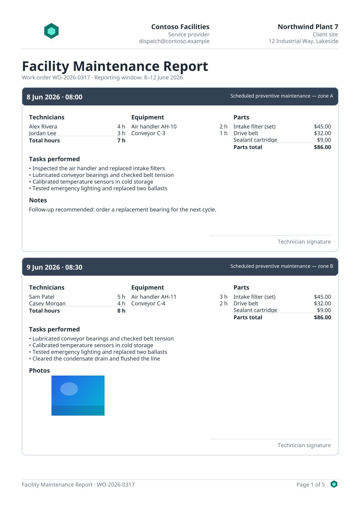</a> | **Annual report** — title + metric cards, 120-row ledger with a repeating header, zebra striping, periodic subtotals and a grand total; **5 pages**.<br>[code](composepdf/src/commonMain/kotlin/io/github/rikoappdev/composepdf/examples/ExampleDocuments.kt#L607) · [PDF](samples/annual-report.pdf)<br><a href="samples/annual-report.pdf">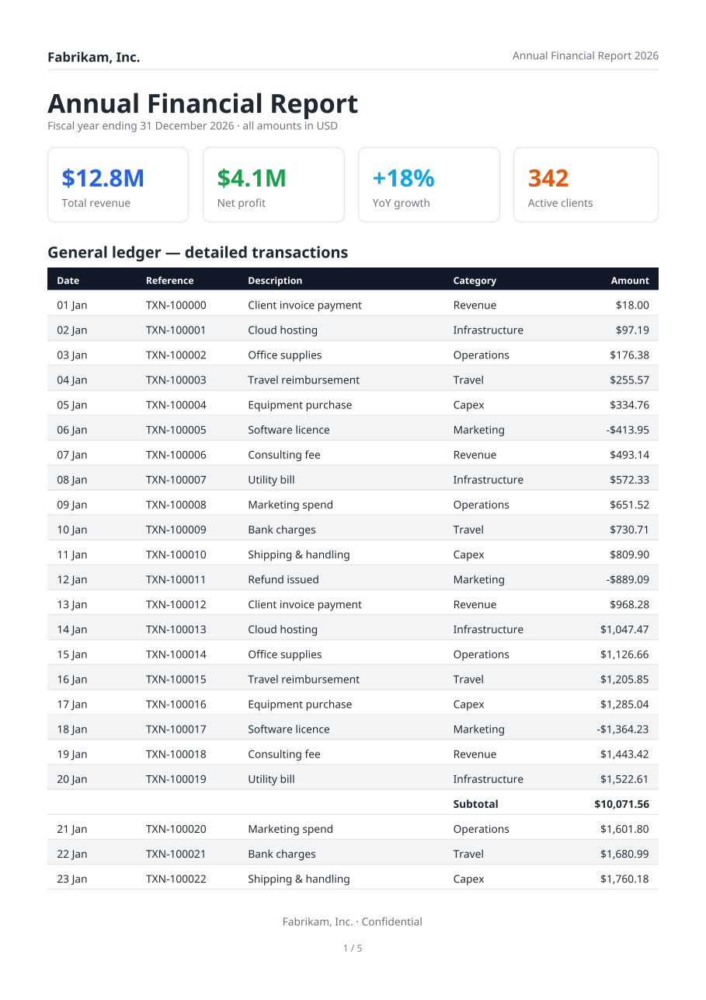</a> |
| **Product catalogue** — SVG brand mark in the header, categorized tables interleaved with photo grids; **3 pages**.<br>[code](composepdf/src/commonMain/kotlin/io/github/rikoappdev/composepdf/examples/ExampleDocuments.kt#L676) · [PDF](samples/product-catalog.pdf)<br><a href="samples/product-catalog.pdf">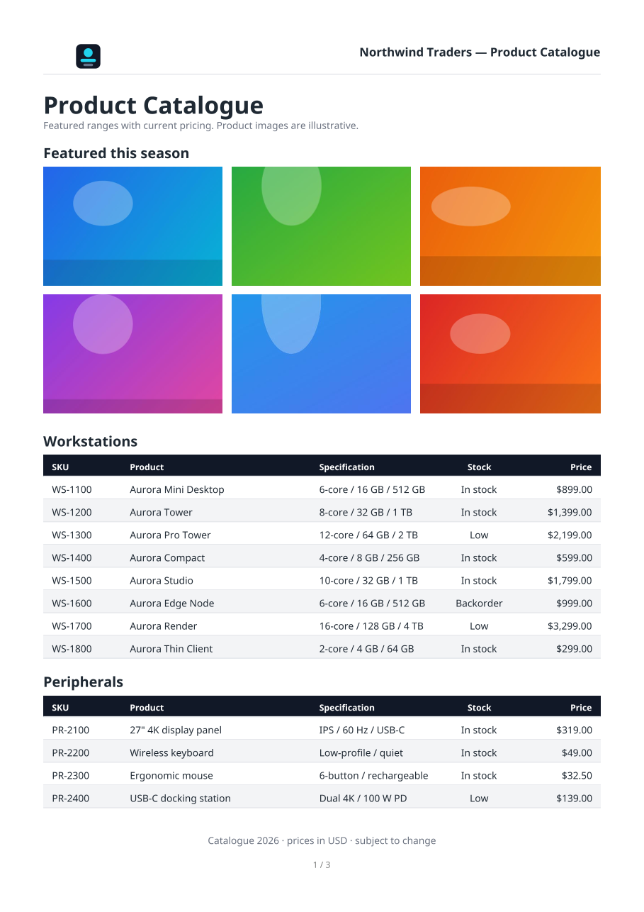</a> | **Service agreement** — 16 numbered sections of wrapped paragraphs (keep-together) + a signatures block; **6 pages**.<br>[code](composepdf/src/commonMain/kotlin/io/github/rikoappdev/composepdf/examples/ExampleDocuments.kt#L767) · [PDF](samples/service-agreement.pdf)<br><a href="samples/service-agreement.pdf"></a> |
| **Invoice** — weighted header columns, line-item table, stacked totals.<br>[code](composepdf/src/commonMain/kotlin/io/github/rikoappdev/composepdf/examples/ExampleDocuments.kt#L79) · [PDF](samples/invoice.pdf)<br><a href="samples/invoice.pdf">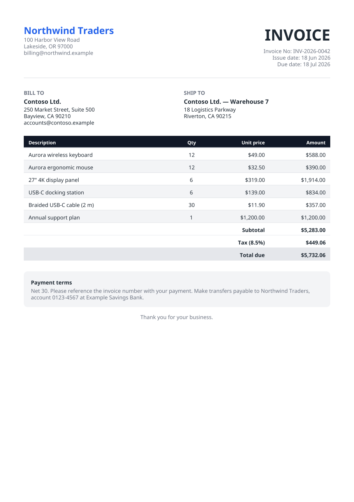</a> | **Business letter** — letterhead and automatically wrapped body paragraphs.<br>[code](composepdf/src/commonMain/kotlin/io/github/rikoappdev/composepdf/examples/ExampleDocuments.kt#L156) · [PDF](samples/business-letter.pdf)<br><a href="samples/business-letter.pdf">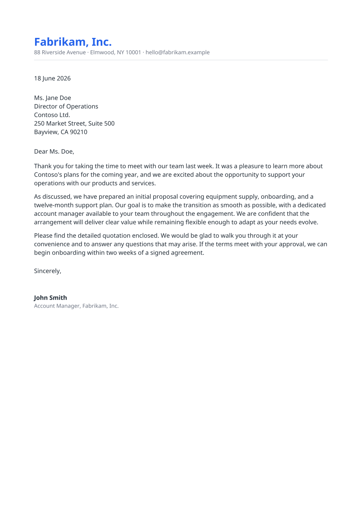</a> |
| **Price list** — repeating header band, multiple categorized tables.<br>[code](composepdf/src/commonMain/kotlin/io/github/rikoappdev/composepdf/examples/ExampleDocuments.kt#L206) · [PDF](samples/price-list.pdf)<br><a href="samples/price-list.pdf">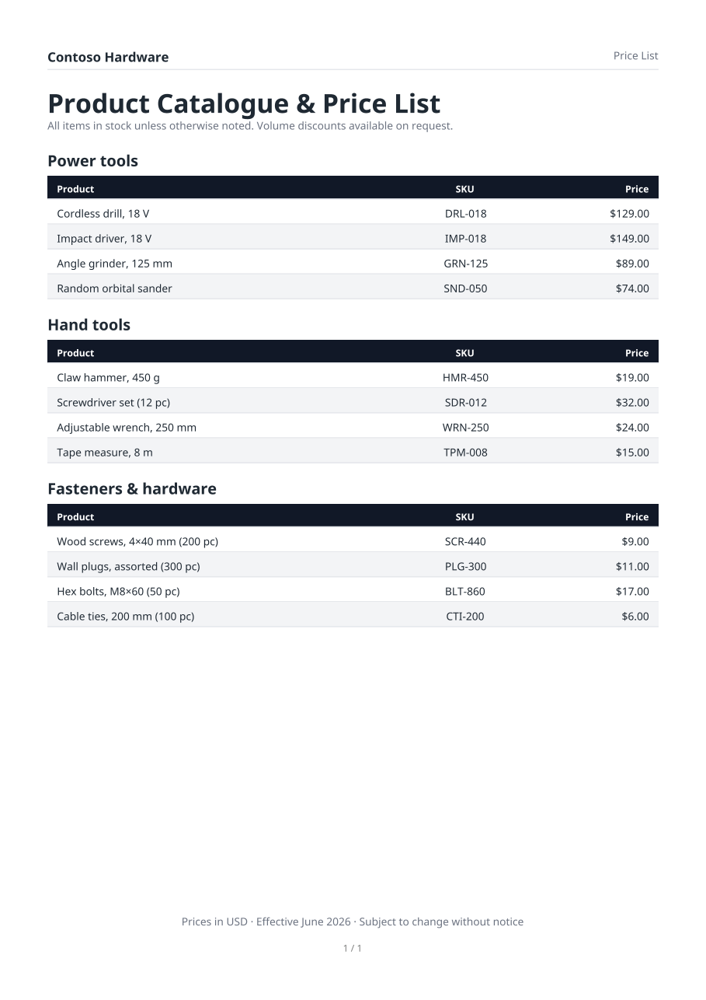</a> | **Status report** — summary box, metric cards, milestones table.<br>[code](composepdf/src/commonMain/kotlin/io/github/rikoappdev/composepdf/examples/ExampleDocuments.kt#L269) · [PDF](samples/status-report.pdf)<br><a href="samples/status-report.pdf">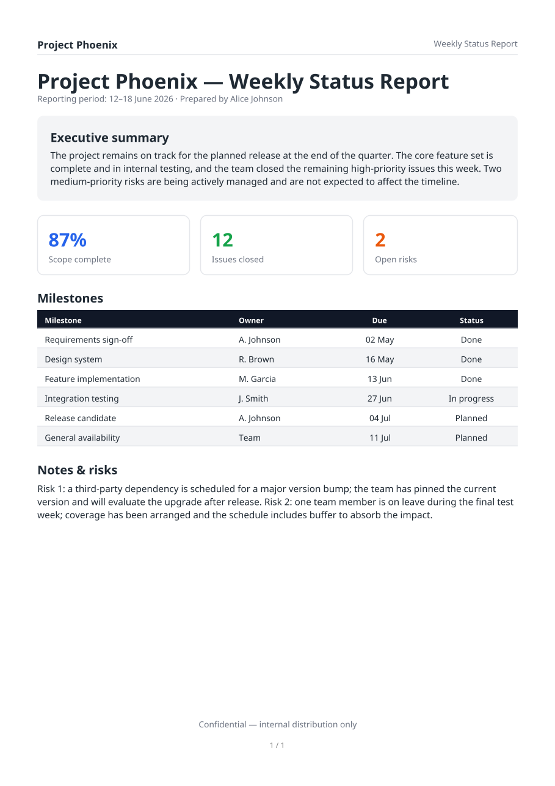</a> |
| **Transaction ledger** — 90 rows over **3 pages**, repeating table header + page numbers.<br>[code](composepdf/src/commonMain/kotlin/io/github/rikoappdev/composepdf/examples/ExampleDocuments.kt#L345) · [PDF](samples/transaction-ledger.pdf)<br><a href="samples/transaction-ledger.pdf">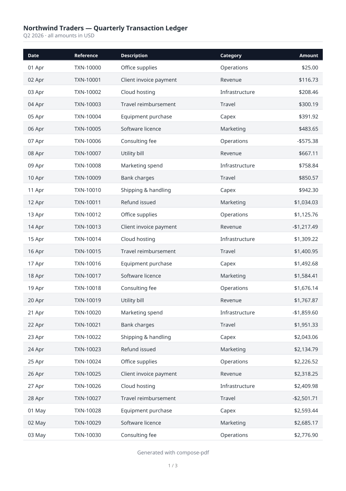</a> | **Photo gallery** — mixed aspect ratios laid out with `PhotoFit.Smart` / `Contain`.<br>[code](composepdf/src/commonMain/kotlin/io/github/rikoappdev/composepdf/examples/ExampleDocuments.kt#L392) · [PDF](samples/photo-gallery.pdf)<br><a href="samples/photo-gallery.pdf">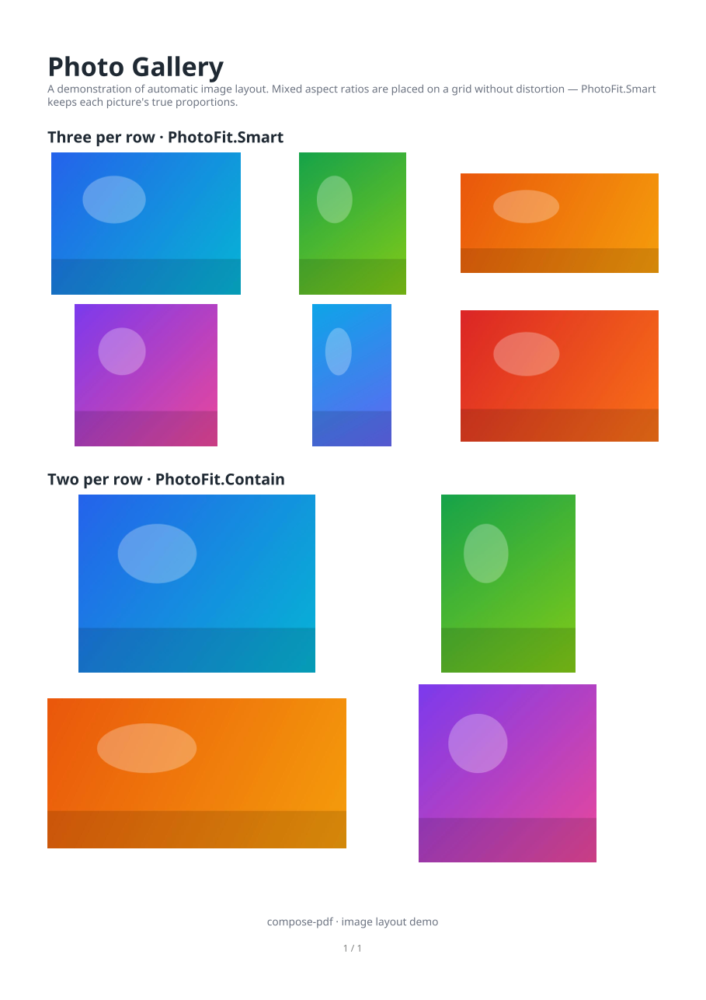</a> |
| **Résumé** — weighted two-column CV, section headings, a skills table; 1 page.<br>[code](composepdf/src/commonMain/kotlin/io/github/rikoappdev/composepdf/examples/ExampleDocuments.kt#L842) · [PDF](samples/resume.pdf)<br><a href="samples/resume.pdf">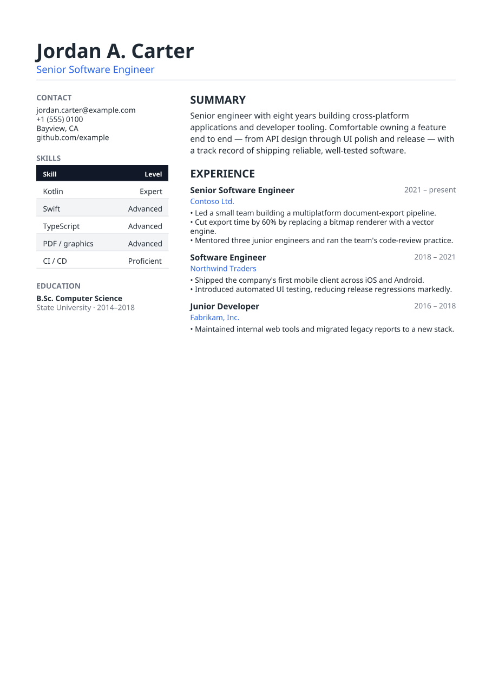</a> | **Event program** — header band + agenda schedule tables; 1 page.<br>[code](composepdf/src/commonMain/kotlin/io/github/rikoappdev/composepdf/examples/ExampleDocuments.kt#L928) · [PDF](samples/event-program.pdf)<br><a href="samples/event-program.pdf">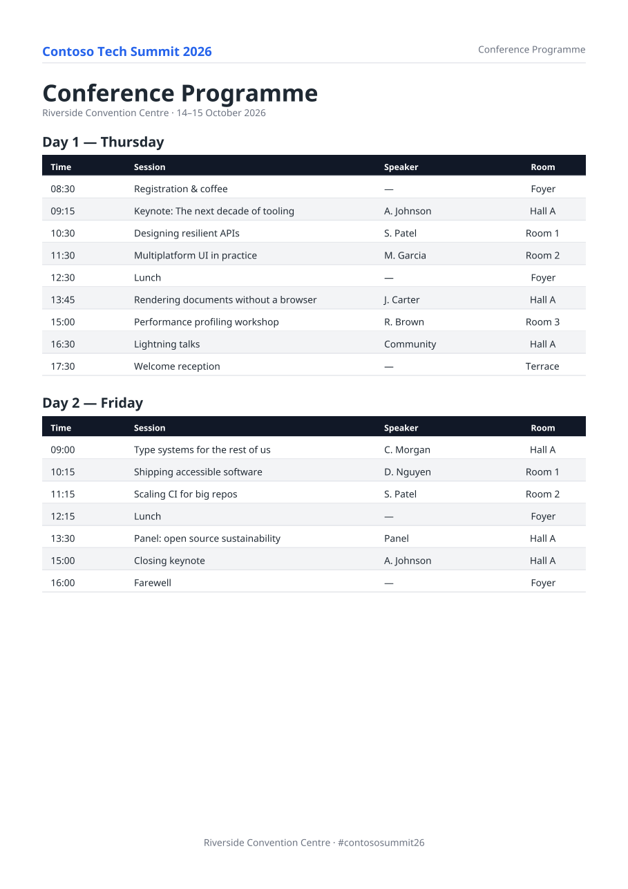</a> |

## Live preview (design-time `@Preview`)

The optional **`compose-pdf-preview`** artifact renders a `pdfDocument { … }` spec onto a Compose
`Canvas`, reusing the engine's **computed layout** — so you see your document **in the IDE preview
pane as you edit the builder**, with no app run and no export. It's a design-time tool (like a
`@Preview` of a screen), not an in-app "view instead of download" button.

```kotlin
// in androidMain — Android Studio renders androidMain @Preview live
@PdfDocumentPreview                            // pick …2Pages / …3Pages … 5Pages for longer reports
@Composable
fun MyReportPreview() = PdfPreview(
    myReport(data),                            // your pdfDocument { … } spec
    previewFontRegular(), previewFontBold(),   // a bundled font, loaded SYNCHRONOUSLY for @Preview
    pageWidth = PreviewPageWidthDp.dp,         // fixed page width → the preview self-sizes to the doc
)
```

- **Ready-made sizing annotations.** Android Studio's static `@Preview` needs `heightDp` as a
  compile-time constant, so a tall multi-page document otherwise gets clipped or padded with an empty
  strip. The artifact ships `@PdfDocumentPreview` (1 page) and `@PdfDocumentPreview2Pages` …
  `@PdfDocumentPreview5Pages` with the exact size baked in for a `PreviewPageWidthDp` (360 dp) page —
  put the one matching your report's page count on the `@Composable` and pass
  `pageWidth = PreviewPageWidthDp.dp`, and the pane shows every page in full (nothing clipped, no empty
  strip). A plain `@Preview` works too if you size it yourself.
- `previewFontRegular()` / `previewFontBold()` load a bundled Noto Sans **synchronously** — the async
  Compose-resources API does not work in the IDE preview runtime. (For the real export, pass your own
  `.ttf` to `render()`; the core stays font-agnostic and bundles no font.)
- Ready-to-open examples ship in the artifact (`ExamplePreviews.kt`): open it in the IDE and the pane
  renders the sample documents immediately.
- The preview runs the **same** layout pass as `render()`, so page count, line breaks, tables, boxes,
  images and vectors land where the PDF puts them. Each glyph is drawn at the engine's exact x, so
  columns and alignment match the PDF; only the glyph shapes come from the platform font (a faithful
  approximation — the PDF stays the source of truth).
- Targets **Android + JVM** (the platforms with an IDE preview runtime); the core engine remains
  Android + iOS + JVM. The UI-free `PdfDocumentSpec.previewPages(regular, bold)` in the core returns
  the resolved per-page draw model if you want to paint it on a different surface.

## Fonts

Fonts are supplied by **your application**, not bundled in the library. `render` takes the Regular
and Bold face bytes; the engine subsets and embeds only the glyphs a document uses. This keeps the
library font-agnostic and dependency-free, and gives identical output on every platform — the app
reads its own `.ttf` (via Compose Resources, Android assets, a file, the network, …) and passes the
bytes in.

A typical app keeps one **default** face and optionally lets the user pick another for export:

```kotlin
val regular: ByteArray = loadFont(selectedFont ?: defaultFont)        // your resource mechanism
val bold: ByteArray = loadFont((selectedFont ?: defaultFont).bold)
val pdf = document.render(regular, bold)
```

Any TrueType font works. For Latin diacritics (e.g. Czech/Slovak/Polish) pick a face that covers
Latin Extended-A/B, such as Noto Sans or DejaVu Sans.

### Color emoji

Pass an optional **color-emoji font** as a third argument and code points your text faces can't
render are drawn inline as real color bitmaps (the "phone" emoji look) instead of `.notdef` boxes:

```kotlin
val emoji: ByteArray = loadFont("NotoColorEmoji.ttf")   // an sbix or CBDT/CBLC color font
val pdf = document.render(regular, bold, emoji)
```

- Supported font formats: Apple **`sbix`** (Apple Color Emoji) and Google **`CBLC`/`CBDT`** (the
  classic large `NotoColorEmoji.ttf`) — each glyph carries a PNG, embedded as a normal image XObject.
- **Not** used: color **vector** fonts (`COLR`/`CPAL`, e.g. Segoe UI Emoji and Noto's newer COLRv1
  build) — they need an outline rasterizer; such code points fall back to the text `.notdef`.
- Single–code-point emoji are supported. ZWJ sequences (👨‍👩‍👧) and skin-tone modifiers render their
  base emoji (the joiner/modifier is dropped) since the engine does no GSUB shaping yet.
- Omitting the argument keeps output byte-for-byte identical to before — the feature is opt-in.
- The on-screen [`@Preview` bridge](#live-preview-design-time-preview) renders emoji code points as
  text (`.notdef`), not color bitmaps — the color emoji live in the exported PDF only.

### Unbounded documents: lazy image sources + `renderTo`

Two things scale with a photo report: the photos you hold, and the finished PDF. Drop both and the
document size stops mattering — **`PdfImageSource` for the photos, `renderTo` for the file**.

```kotlin
val document = pdfDocument {
    // Photos addressed by file. Nothing is read until the engine needs it.
    photoGrid(paths.map { path -> PdfImageSource { File(path).readBytes() } }, perRow = 3, cellHeight = 96.dp)
}

FileOutputStream(target).buffered().use { out ->
    document.renderTo({ bytes, offset, length -> out.write(bytes, offset, length) }, regular, bold)
}
```

- `PdfImageSource` is a `fun interface` with a single `readBytes()` — a file, a content-provider
  stream, a cache entry. `image(source, …)` and `photoGrid(sources, …)` are the primary forms;
  `image(bytes, …)` / `photoGrid(listOfByteArrays, …)` are convenience overloads that wrap the array
  in a source that returns it. There is **one** image path, not a separate "streaming mode".
- A **JPEG** is read once when the DSL records it — just to read its `/DCTDecode` dimensions and
  size — then dropped, and pulled back **one photo at a time** while the file is written. A **PNG**
  is decoded eagerly and kept: its `/Length` is the *deflated* size, which is only knowable by
  compressing it, and that length is written before the payload. PNGs are logos, not photo streams.
- `readBytes()` **must return the same bytes every time**: `/Length` and every later cross-reference
  offset come from the first measurement. A changed length aborts the render with a message naming
  the source rather than emitting a corrupt xref.
- `PdfSink` is a `fun interface` with a single `write(bytes, offset, length)` — adapt it to any
  destination (a `FileOutputStream`, an `NSFileHandle`, a digest). The engine writes strictly
  sequentially, never seeks, and calls `write` from the single thread `renderTo` runs on.
- Output is **byte-for-byte identical** across all four combinations — eager or lazy, `render()` or
  `renderTo()`. Only the memory profile changes:

  | photos supplied as | `render()` → `ByteArray` | `renderTo(sink)` |
  |---|---|---|
  | `ByteArray` | your photos + the whole file | your photos |
  | `PdfImageSource` | one photo + the whole file | **one photo** |

- Measured (`MemoryStressTest`, synthetic 444 KB photos, forked JVM): an **870-photo, 397 MB** report
  streams from file-backed sources in a **64 MiB heap**, live set 3.5 MiB above baseline — and
  doubling the photo count moves that by 1.14×, not 2×.
- Emoji, fonts and `onProgress` work exactly as in `render`. If the sink throws, the exception
  propagates and cleaning up the partial file is the caller's job.

## Building & testing

```
./gradlew :composepdf:jvmTest                          # identity + feature gates (incl. cross-platform golden)
./gradlew :composepdf:compileCommonMainKotlinMetadata  # shared-code purity check
./gradlew :composepdf:compileAndroidMain               # Android target
./gradlew :composepdf:iosSimulatorArm64Test            # runs the golden on iOS (macOS only)

# Opt-in memory harness (minutes, hundreds of MB of temp disk; excluded from `check`/CI):
./gradlew :composepdf:jvmStressTest                                                       # eager ladder, 460m heap
./gradlew :composepdf:jvmStressTest -PstressHeap=128m -PstressTests="*MemoryStressTest.c_*"  # lazy-source ladder
```
Requires JDK 17+ (CI uses 21). The cross-platform golden test runs the layout engine over a fixed
document with deterministic metrics and asserts identical integer glyph origins on every platform.
Generated test PDFs/PNGs are written under `composepdf/build/`.

## Roadmap

- **`wasmJs` target** — the engine is dependency-free `commonMain`, so a browser/Node build is mostly
  build configuration; `PdfSink`/`PdfImageSource` already fit Web Worker + OPFS streaming. (For web
  apps, server-side generation through the existing JVM target is the recommended path — same
  builders, byte-identical output.)
- GPOS kerning / ligatures.
- More image formats (WebP, …).
- Complex scripts / RTL / bidi.
- Color **vector** emoji (`COLR`/`CPAL`) and ZWJ / skin-tone sequences.
- Long-word breaking inside narrow columns.
- Full-bleed bands (edge-to-edge colour bars), a band distance from the page edge different from `margin`, and separate top / bottom / left / right margins.
